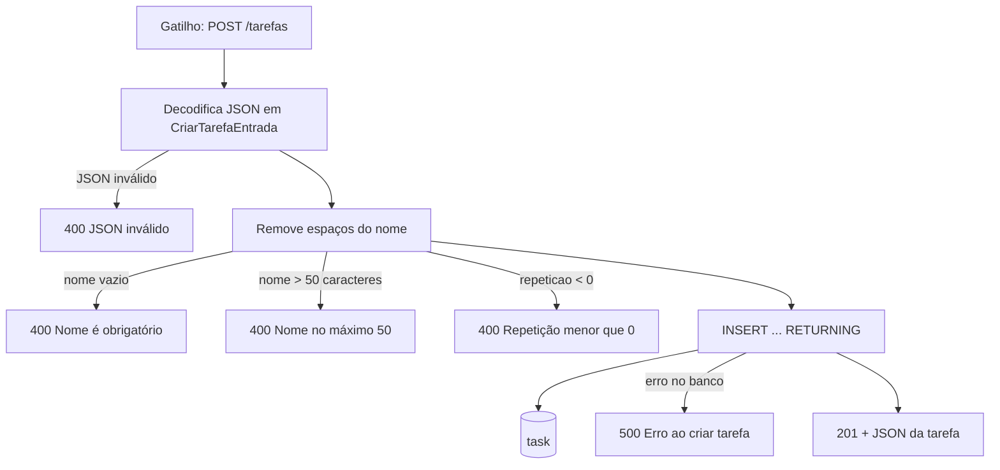
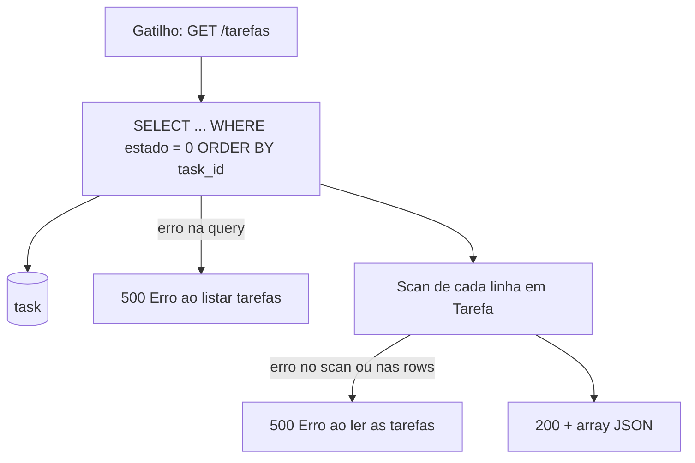
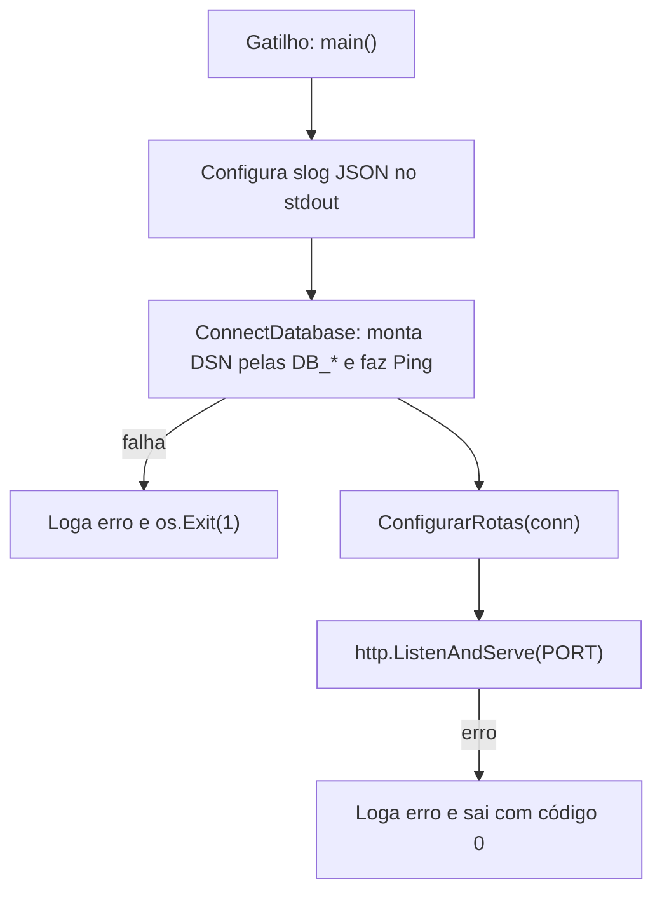
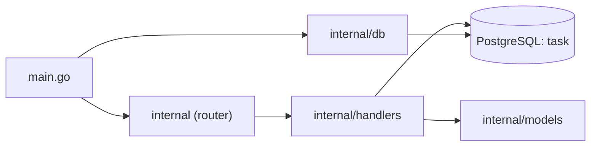

# Análise do sistema Tasklet API

> Gerado em 2026-10-21 · Alvo: `tasklet_api/` · Linguagens (por LOC): Go 74%, YAML 11%, Build (Dockerfile/go.mod) 10%, SQL 3%, outros 2% · Extrator: universal-ctags + regex

**Escopo assumido:** raiz do repositório inteira, incluindo testes (são a melhor especificação viva); nada excluído. `.env` lido só pelos nomes das chaves (valores não reproduzidos, exceto o formato de `PORT`). Nome do sistema vem do módulo Go `tasklet_api` (`go.mod:1`). Analisado o working tree da branch `andre/feature/teste-persistencia-tarefa`, que tem uma alteração local em `internal/router_test.go`.

## 1. Resumo executivo

**Objetivo do sistema:** API REST de lista de tarefas (to-do) pessoal. Permite **cadastrar uma tarefa** (nome, descrição, prazo, repetição e dia de execução) e **listar as tarefas pendentes**, guardando tudo num PostgreSQL. O modelo de dados já prevê estados (pendente, concluída, atrasada), tarefas recorrentes e etiquetas (tags), mas só criação e listagem de pendentes estão implementadas. O próprio autor descreve o projeto como um projeto para aprender Go (`internal/models/tarefa.go:8`).

**Confiança:** Alta. A base é pequena (2 rotas, 1 tabela em uso) e cada comportamento é explícito no código e coberto por testes.

**Principais processos:**
1. Criar tarefa: `POST /tarefas` valida a entrada e grava em `task` com estado *pendente*.
2. Listar tarefas pendentes: `GET /tarefas` devolve as tarefas com `estado = 0`, ordenadas por id.
3. Inicializar o serviço (suporte): sobe o log JSON, conecta no PostgreSQL e abre o servidor HTTP.

**Evidências-chave:**
- Rotas registradas: `GET /tarefas` e `POST /tarefas` (`internal/router.go:15-16`)
- Entidade única do domínio: `Tarefa` (`internal/models/tarefa.go:17`)
- Estados enumerados 0/1/2 (`internal/models/tarefa.go:12-14`) e reforçados no banco por `CHECK (estado IN (0, 1, 2))` (`scripts/init.sql:5`)
- INSERT e SELECT sobre `task` (`internal/handlers/tarefas.go:26-37`)
- Tabelas `tag` e `possui_uma` criadas mas nunca usadas pelo código (`scripts/init.sql:11-22`)

## 2. Processos de negócio

### 2.1 Criar tarefa

- **Gatilho:** `POST /tarefas` (`internal/router.go:16`)
- **Atores/sistemas:** cliente HTTP (qualquer um, sem autenticação) → API → PostgreSQL
- **Resultado:** uma linha nova em `task`, com `estado = 0` (pendente) por default do banco. A resposta é `201` com a tarefa criada em JSON.

| # | Passo | Implementado em | Dados | Regra de negócio |
|---|---|---|---|---|
| 1 | Decodifica o corpo | `TarefaHandler.CriarTarefaHandler` (`internal/handlers/tarefas.go:43`) | corpo JSON | JSON malformado → 400. Campos desconhecidos são ignorados em silêncio. |
| 2 | Normaliza e valida o nome | idem (`internal/handlers/tarefas.go:48-57`) | — | Nome obrigatório após `TrimSpace`. No máximo 50 caracteres Unicode, contados em runas, alinhado a `VARCHAR(50)` (`scripts/init.sql:3`). |
| 3 | Valida a repetição | idem (`internal/handlers/tarefas.go:59`) | — | `repeticao >= 0`, duplicado no banco por `CHECK (repeticao >= 0)` (`scripts/init.sql:7`) |
| 4 | Grava e lê de volta | idem (`internal/handlers/tarefas.go:64-80`), query `queryInsertion` (`:26`) | `task` INSERT | `estado` não é aceito na entrada: sempre nasce 0 (pendente) pelo `DEFAULT 0` (`scripts/init.sql:5`) |
| 5 | Responde | idem (`internal/handlers/tarefas.go:88-93`) | — | 201 + `Content-Type: application/json` |

Fato observado: `prazo`, `descricao` e `dia_execucao` são gravados sem validação. Um prazo no passado é aceito, por exemplo.

### 2.2 Listar tarefas pendentes

- **Gatilho:** `GET /tarefas` (`internal/router.go:15`)
- **Atores/sistemas:** cliente HTTP → API → PostgreSQL
- **Resultado:** nenhum efeito colateral. Devolve `200` com um array JSON (vazio `[]`, nunca `null`) das tarefas pendentes, em ordem de `task_id`.

| # | Passo | Implementado em | Dados | Regra de negócio |
|---|---|---|---|---|
| 1 | Consulta pendentes | `TarefaHandler.ListarTarefasPendentesHandlers` (`internal/handlers/tarefas.go:99`), query `queryPending` (`:32`) | `task` SELECT | Só `estado = EstadoPendente (0)`. A listagem padrão esconde concluídas e atrasadas. |
| 2 | Monta a lista | idem (`internal/handlers/tarefas.go:107-127`) | — | Slice inicializado vazio, então a resposta é `[]` e não `null`. O teste exige isso (`internal/listar_tarefas_integration_test.go:28`). |
| 3 | Verifica erro de iteração | idem (`internal/handlers/tarefas.go:129`) | — | — |
| 4 | Responde | idem (`internal/handlers/tarefas.go:135-136`) | — | 200. Um erro no `Encode` é ignorado. |

Não há paginação nem filtro: a rota devolve todas as pendentes.

### 2.3 Inicializar o serviço (suporte técnico)

- **Gatilho:** execução do binário (`main.go:12`), via `docker compose up` (`docker-compose.yml:24-37`)
- **Atores/sistemas:** Docker Compose, PostgreSQL 16
- **Resultado:** servidor HTTP escutando no endereço de `PORT`

| # | Passo | Implementado em | Dados | Regra de negócio |
|---|---|---|---|---|
| 1 | Logger estruturado | `main` (`main.go:14`) | stdout | — |
| 2 | Conexão com o banco | `db.ConnectDatabase` (`internal/db/db.go:12-38`) | env `DB_HOST/USER/PASSWORD/PORT/NAME` | `sslmode=disable` fixo (`internal/db/db.go:20`) |
| 3 | Rotas | `internal.ConfigurarRotas` (`internal/router.go:10`) | — | — |
| 4 | Servidor | `main` (`main.go:25-30`) | env `PORT` | `PORT` precisa vir no formato `":8080"`, porque é passada crua a `ListenAndServe` |

O schema do banco só é criado no **primeiro** start do volume, por `docker-entrypoint-initdb.d` (`docker-compose.yml:15`). Não existe ferramenta de migração.

## 3. Arquitetura e módulos

Monólito HTTP pequeno em Go 1.27, só com a biblioteca padrão (`net/http` com padrões de rota `"METHOD /path"`, `database/sql`, `log/slog`) e o driver `pgx/v5/stdlib`. São três camadas finas: roteador → handler (validação, SQL e resposta juntos, sem camada de serviço ou repositório) → models. A infraestrutura é Docker multi-stage, Compose para dev e testes, e GitHub Actions rodando os testes num PostgreSQL temporário.

| Módulo | Responsabilidade | Principais tipos/funções |
|---|---|---|
| `main` | Bootstrap: log, banco, servidor | `main` |
| `internal` | Registro de rotas | `ConfigurarRotas` |
| `internal/db` | Abrir e testar a conexão | `ConnectDatabase` |
| `internal/handlers` | Casos de uso HTTP + SQL | `TarefaHandler`, `CriarTarefaEntrada`, `queryInsertion`, `queryPending` |
| `internal/models` | Entidade e estados | `Tarefa`, `EstadoTarefa`, `Estado*` |
| `scripts/` | Schema do banco | `task`, `tag`, `possui_uma` |
| infra | Build, execução, CI | `Dockerfile`, `docker-compose.yml`, `compose.test.yml`, `.github/workflows/tests.yml` |

## 4. Catálogo de tipos (classes / structs / records)

### `Tarefa` (struct): `internal/models/tarefa.go:17`
**Papel:** tarefa do usuário. É a única entidade de domínio em uso, espelho da tabela `task`, e é o formato de resposta das duas rotas.

| Atributo | Tipo | Significado |
|---|---|---|
| `ID` (`id`) | `int` | Identificador (`task_id SERIAL`) |
| `Nome` (`nome`) | `string` | Título da tarefa, de 1 a 50 caracteres |
| `Prazo` (`prazo`) | `*time.Time` | Data limite, opcional. Inferência (Média): base futura para o estado *atrasada* |
| `Descricao` (`descricao`) | `*string` | Texto livre, opcional |
| `Estado` (`estado`) | `EstadoTarefa` | Situação: 0 pendente, 1 concluída, 2 atrasada |
| `Repeticao` (`repeticao`) | `int` | Recorrência, ≥ 0, com 0 = não repete. Inferência (Baixa): intervalo ou quantidade de repetições; a unidade não está definida no código |
| `DiaExecucao` (`dia_execucao`) | `*time.Time` | Quando a tarefa deve ser feita, opcional. Inferência (Média): data agendada, distinta do prazo |

Métodos: nenhum.

### `EstadoTarefa` (alias de `int`): `internal/models/tarefa.go:5`
**Papel:** enumeração do ciclo de vida da tarefa. O comentário em `:7-10` avisa que os valores são persistidos como número, então reordenar as constantes corromperia o significado dos dados já gravados.

| Constante | Valor | Significado |
|---|---|---|
| `EstadoPendente` | 0 | A fazer (default no banco) |
| `EstadoConcluida` | 1 | Feita. Nenhum código atribui esse valor. |
| `EstadoAtrasada` | 2 | Passou do prazo. Nenhum código atribui esse valor. |

### `TarefaHandler` (struct): `internal/handlers/tarefas.go:14`
**Papel:** agrupa os handlers HTTP de tarefas e carrega a dependência do banco.

| Atributo | Tipo | Significado |
|---|---|---|
| `DB` | `*sql.DB` | Pool de conexões com o PostgreSQL |

| Método | Assinatura | O que faz |
|---|---|---|
| `CriarTarefaHandler` | `(w http.ResponseWriter, r *http.Request)` (`:39`) | Valida a entrada, insere a tarefa e responde 201 com o JSON |
| `ListarTarefasPendentesHandlers` | `(w http.ResponseWriter, r *http.Request)` (`:96`) | Lista as tarefas com estado pendente e responde 200 com um array JSON |

### `CriarTarefaEntrada` (struct, DTO): `internal/handlers/tarefas.go:18`
**Papel:** contrato de entrada de `POST /tarefas`.

| Atributo | Tipo | Significado |
|---|---|---|
| `Nome` | `string` | Obrigatório, até 50 caracteres |
| `Prazo` | `*time.Time` | Opcional, em RFC 3339 |
| `Descricao` | `*string` | Opcional |
| `Repeticao` | `int` | Opcional (default 0), ≥ 0 |
| `DiaExecucao` | `*time.Time` | Opcional, em RFC 3339 |

Não há campo `estado`, então o cliente não escolhe o estado inicial.

### Tabelas SQL (`scripts/init.sql`)

| Tabela | Linha | Papel |
|---|---|---|
| `task` | `:1` | Persistência de `Tarefa` |
| `tag` | `:11` | Etiqueta (`tag_id`, `nome VARCHAR(50)`). Sem uso no código. |
| `possui_uma` | `:16` | Associação N:N entre tarefa e tag, com `ON DELETE CASCADE`. Sem uso no código. |

## 5. Catálogo de funções

| Função | Módulo | Assinatura | O que faz | Chamada por |
|---|---|---|---|---|
| `main` | `main` (`main.go:12`) | `func main()` | Configura o log, conecta no banco, monta as rotas e sobe o HTTP | runtime / `CMD ["./meu-app"]` (`Dockerfile:30`) |
| `ConnectDatabase` | `internal/db` (`internal/db/db.go:12`) | `func ConnectDatabase() (*sql.DB, error)` | Monta o DSN a partir de `DB_*`, abre o pool `pgx` e faz `Ping` | `main` (`main.go:17`) |
| `ConfigurarRotas` | `internal` (`internal/router.go:10`) | `func ConfigurarRotas(conn *sql.DB) *http.ServeMux` | Cria o `ServeMux` com `GET/POST /tarefas` | `main` (`main.go:26`), testes de integração e de rota |
| `conectarBancoDeTeste` | `internal` (teste) (`internal/criar_tarefa_integration_test.go:91`) | `func conectarBancoDeTeste(t *testing.T) *sql.DB` | Conecta via `TEST_DATABASE_URL` ou pula o teste (`t.Skip`) | testes de integração |
| `TestCriarTarefaIntegracao` | teste (`internal/criar_tarefa_integration_test.go:18`) | — | Cria uma tarefa via HTTP e confere a resposta e o que foi gravado (estado 0, repetição 0) | `go test` |
| `TestListarTarefasPendentesIntegracao` | teste (`internal/listar_tarefas_integration_test.go:12`) | — | Confere a lista vazia, depois a inserção de 2 pendentes + 1 concluída + 1 atrasada e que só as 2 pendentes voltam, em ordem | `go test` |
| `TestCriarTarefaRotaRegistrada` | teste (`internal/router_test.go:10`) | — | Confere que `POST /tarefas` chega ao handler (400 com nome vazio) | `go test` |
| `TestCriarTarefaNomeVazio`, `TestCriarTarefaRepeticaoNegativa`, `TestCriarTarefaJSONInvalido`, `TestLimiteQuantidadeCaracteres` | `internal/handlers` (`internal/handlers/tarefas_test.go:11,28,45,62`) | — | Testes unitários das 4 validações de entrada (todas devem dar 400) | `go test` |

## 6. Dados e integrações

### Dados persistidos
| Tabela/arquivo | Operações | Processos que usam | Significado |
|---|---|---|---|
| `task` | INSERT (2.1), SELECT (2.2). DELETE só em testes. | Criar tarefa, Listar pendentes | Tarefas do usuário |
| `tag` | nenhuma | — | Etiquetas (planejado) |
| `possui_uma` | nenhuma | — | Vínculo tarefa↔tag (planejado) |

### Integrações externas
| Destino | Tipo (HTTP, fila, arquivo, CALL) | Quando ocorre | `arquivo:linha` |
|---|---|---|---|
| PostgreSQL 16 | SQL via `pgx/v5` | No start (`Ping`) e em cada requisição | `internal/db/db.go:24`, `internal/handlers/tarefas.go:64,99` |
| GitHub Actions | CI (`docker compose run tests`) | Push e PR para `main` | `.github/workflows/tests.yml:3-23` |

Não há chamadas a APIs externas, filas nem I/O de arquivo.

## 7. Inventário

| Linguagem | Arquivos | LOC |
|---|---|---|
| Go | 9 | 439 |
| YAML | 2 | 66 |
| Build (Dockerfile, go.mod, go.sum) | 3 | 61 |
| SQL | 1 | 20 |
| Outra (`.env`, `.gitignore`) | 2 | 11 |

Símbolos: 7 tipos (3 structs Go + 1 alias + 3 tabelas SQL), 13 atributos, 2 métodos, 11 funções (3 de produção + 8 de teste), 5 constantes. Pontos de entrada: 3 (`main` + 2 rotas). Arquivos não indexados: 2 (`.env`, `.gitignore`, ambos lidos). LOC conta linhas não vazias segundo o script; `wc -l` dá 541 linhas brutas de Go.

## 8. Riscos e lacunas

- **Build quebrado no working tree (urgente):** `internal/router_test.go:27` termina em `func` sem corpo (é a alteração local não commitada). `go vet ./...` falha com `expected 'IDENT', found 'EOF'`. Com isso, `go test ./...` não compila o pacote `internal`, e o `docker build` também quebra, porque roda os testes (`Dockerfile:15`). Se isso for commitado, o CI fica vermelho.
- **Código possivelmente morto:**
  - Tabelas `tag` e `possui_uma` (`scripts/init.sql:11-22`): nenhum código as lê ou escreve.
  - `EstadoConcluida` e `EstadoAtrasada` (`internal/models/tarefa.go:13-14`) aparecem só nos testes. Não existe rota para concluir uma tarefa nem rotina que marque atraso.
  - `repeticao` e `dia_execucao` são gravados mas não têm nenhuma lógica (não geram próxima ocorrência).
  - Chave `DATABASE_URL` no `.env`: o código usa as `DB_*` separadas.
  - Dependências em `go.mod` sem uso no código: `joho/godotenv`, `docker/docker`, `containerd/errdefs`, `ishidawataru/sctp`. Além disso, todas estão marcadas `// indirect`, inclusive `pgx`, que é direta. Um `go mod tidy` resolve.
- **Regras de negócio hardcoded:** limite de 50 caracteres duplicado no Go (`internal/handlers/tarefas.go:54`) e no SQL (`scripts/init.sql:3`). Estados 0/1/2 duplicados no Go e no `CHECK` (`scripts/init.sql:5`), um acoplamento que o próprio autor aponta.
- **Pontos frágeis:**
  - `ListenAndServe` sem timeouts (`ReadHeaderTimeout` etc.), sem limite de tamanho do corpo (`http.MaxBytesReader`) e sem graceful shutdown (`main.go:28`).
  - Se o servidor falha, `main` só loga e termina com código 0 (`main.go:28-30`), então o orquestrador não percebe a falha.
  - `PORT` exige o formato `":8080"`. Com `PORT=8080`, o servidor não sobe.
  - O erro do `Encode` é ignorado na listagem (`internal/handlers/tarefas.go:136`).
  - Sem autenticação nem dono da tarefa: todos os clientes compartilham a mesma lista.
  - `TIMESTAMP` sem fuso (`scripts/init.sql:6,8`) com `time.Time` com fuso: o offset enviado pelo cliente se perde.
  - `sslmode=disable` fixo (`internal/db/db.go:20`) e Postgres exposto na porta 5432 do host (`docker-compose.yml:12`). Aceitável em dev, ruim fora dele.
  - O schema só é aplicado num volume novo e não há migrações: mudar `init.sql` não altera um banco que já existe.
  - O teste de listagem exige a tabela vazia no início (`internal/listar_tarefas_integration_test.go:39`) e depende de os testes não rodarem em paralelo contra o mesmo banco.
- **Dúvidas abertas (o autor responde):** qual é a unidade de `repeticao` (dias? número de vezes?); qual a diferença entre `prazo` e `dia_execucao`; se *atrasada* vai ser um estado gravado ou calculado na leitura a partir do prazo; qual a relação pretendida para tags.

## 9. Glossário de domínio

| Termo no código | Significado de negócio | Onde aparece |
|---|---|---|
| Tarefa / `task` | Item a fazer do usuário | `internal/models/tarefa.go:17`, `scripts/init.sql:1` |
| Estado | Situação da tarefa no ciclo de vida | `internal/models/tarefa.go:5` |
| Pendente | Ainda não feita (estado inicial) | `internal/models/tarefa.go:12` |
| Concluída | Feita | `internal/models/tarefa.go:13` |
| Atrasada | Passou do prazo sem ser concluída (inferência) | `internal/models/tarefa.go:14` |
| Prazo | Data limite | `internal/models/tarefa.go:20` |
| Repetição | Recorrência (0 = não repete) | `internal/models/tarefa.go:23` |
| Dia de execução | Data agendada para fazer a tarefa | `internal/models/tarefa.go:24` |
| Tag / `possui_uma` | Etiqueta e o vínculo "tarefa possui uma tag" | `scripts/init.sql:11-22` |
