# Mapa de processos — Tasklet API

> Gerado em 2026-10-21 · Alvo: `tasklet_api/` · Linguagens: Go, SQL, YAML · Base: análise estática do código (AS-IS)

**Escopo assumido:** raiz do repositório, working tree da branch `andre/feature/teste-persistencia-tarefa` (inclui alterações não commitadas: `internal/service/`, `internal/repository/`, migrações). Testes lidos só como evidência de cobertura. Nome do sistema vem do módulo Go `tasklet_api` (`go.mod:1`). `docs/legacy-report.md` está desatualizado em relação ao código atual e não foi usado como fonte.

## 1. Visão geral

**Objetivo do sistema:** API REST de gestão de tarefas pessoais. Um cliente HTTP (sem autenticação) cadastra, edita, consulta, conclui e exclui **tarefas**, que podem ter prazo, dia de execução, **recorrência em dias** e **etiquetas (tags)**. O estado "atrasada" é calculado na leitura pelo relógio; ao concluir uma tarefa recorrente, o sistema gera automaticamente a próxima ocorrência. Tudo é persistido em PostgreSQL.

**Confiança:** Alta — base pequena, todas as rotas registradas num único arquivo e todas as transições de estado explícitas no código.

**Processos identificados:**
1. 6.1 Cadastrar tarefa — Usuário → tarefa pendente gravada com etiquetas
2. 6.2 Consultar tarefas — Usuário → lista filtrada (pendentes por padrão) ou uma tarefa, com estado efetivo
3. 6.3 Editar tarefa — Usuário → tarefa aberta alterada (concluída é bloqueada)
4. 6.4 Concluir tarefa (e gerar próxima ocorrência) — Usuário → tarefa concluída + nova ocorrência, se recorrente
5. 6.5 Excluir tarefa — Usuário → tarefa removida definitivamente
6. 6.6 Manter etiquetas — Usuário → etiqueta criada, renomeada, listada ou excluída (desvincula das tarefas)
7. 6.7 Disponibilizar serviço (suporte) — Operação/orquestrador → banco migrado, API no ar, sondas de saúde

## 2. Mapa de contexto

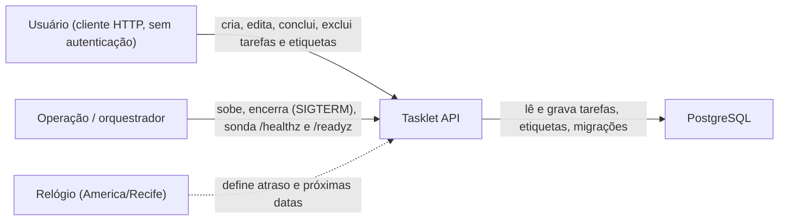

## 3. Atores e papéis

| Ator | Tipo | Como aparece no código | Processos em que participa | Evidência |
|---|---|---|---|---|
| Usuário | Humano (via cliente HTTP) | Rotas públicas, sem checagem de autenticação/perfil | 6.1–6.6 | `internal/router.go:17-26` |
| Operação / orquestrador | Sistema | Inicia o processo, envia SIGINT/SIGTERM, consome sondas de saúde | 6.7 | `main.go:76`, `internal/router.go:27-38`, `docker-compose.yml:18-31` |
| Relógio | Tempo (passivo) | Instante atual injetado; não há agendador — o tempo só age quando alguém lê ou conclui | 6.2, 6.4 | `internal/router.go:12`, `internal/service/tarefas.go:161-175` |
| PostgreSQL | Sistema externo | Armazena todas as entidades e o controle de migrações | todos | `internal/db/db.go:37-48` |

> Integração "s3" apontada pelo script de sinais é falso positivo: não há cliente S3 no código.

## 4. Entidades de negócio

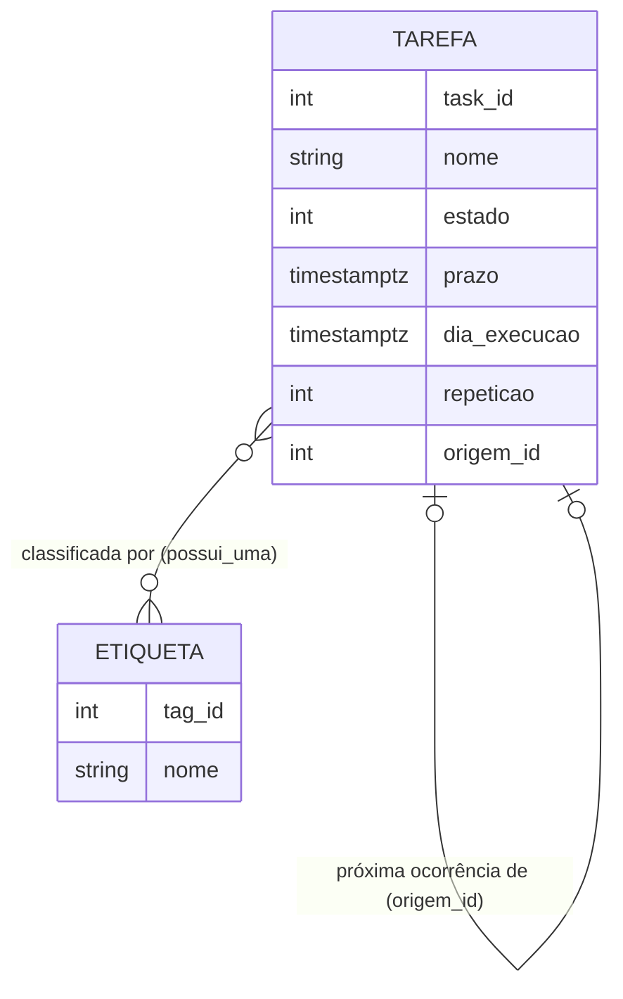

| Entidade | Significado de negócio | Quem cria / altera | Estados | Evidência |
|---|---|---|---|---|
| Tarefa (`task`) | Algo a fazer, com prazo opcional e recorrência em dias (`repeticao`; 0 = não recorre) | Usuário (6.1, 6.3, 6.4, 6.5); Sistema cria a próxima ocorrência (6.4) | Persistidos: Pendente (0), Concluída (1). Calculado: Atrasada (2) | `internal/db/migrations/001_base.sql:1-9`, `002_recorrencia.sql:1-7`, `internal/models/tarefa.go:8-29` |
| Etiqueta (`tag`) | Rótulo livre para classificar tarefas | Usuário (6.6) | — | `001_base.sql:10-13` |
| Vínculo tarefa–etiqueta (`possui_uma`) | Quais etiquetas uma tarefa tem; some ao excluir qualquer lado | Sistema, como efeito de 6.1/6.3/6.4 | — | `001_base.sql:14-18` |

## 5. Arquitetura de processos

### 5.1 Cadeia de valor (nível 0)

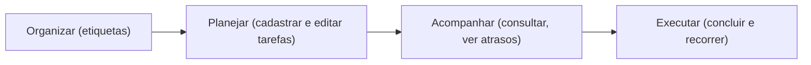

### 5.2 Macroprocessos e encadeamento (nível 1)

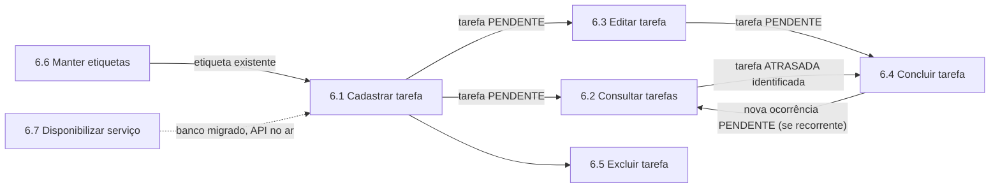

| Macroprocesso | Gatilho | Resultado | Inicia / é iniciado por |
|---|---|---|---|
| 6.1 Cadastrar tarefa | `POST /tarefas` | Tarefa Pendente com etiquetas | Depende de 6.6 se usar etiquetas |
| 6.2 Consultar tarefas | `GET /tarefas`, `GET /tarefas/{id}` | Tarefas com estado efetivo | Alimenta a decisão de concluir (6.4) |
| 6.3 Editar tarefa | `PATCH /tarefas/{id}` | Tarefa aberta alterada | Após 6.1 |
| 6.4 Concluir tarefa | `POST /tarefas/{id}/concluir` | Concluída + próxima ocorrência | Gera nova entrada para 6.2/6.3/6.4 |
| 6.5 Excluir tarefa | `DELETE /tarefas/{id}` | Tarefa removida | Qualquer momento |
| 6.6 Manter etiquetas | `GET/POST /tags`, `PATCH/DELETE /tags/{id}` | Catálogo de etiquetas | Habilita 6.1/6.3 |
| 6.7 Disponibilizar serviço | Início do processo; sondas | Banco migrado, API ouvindo | Pré-requisito de todos |

## 6. Processos detalhados

### 6.1 Cadastrar tarefa

| SIPOC | |
|---|---|
| **Fornecedores** | Usuário |
| **Entradas** | `nome` (obrigatório), `descricao`, `prazo`, `dia_execucao`, `repeticao`, `tag_ids` |
| **Processo** | Valida os dados, grava a tarefa como Pendente e vincula as etiquetas, tudo numa transação |
| **Saídas** | Tarefa criada (201 + `Location: /tarefas/{id}`) com estado efetivo |
| **Clientes** | Usuário |

- **Gatilho:** `POST /tarefas` (`internal/router.go:18`)
- **Resultado esperado:** nova tarefa Pendente (ou já Atrasada, se o prazo é passado) com etiquetas vinculadas
- **Frequência/volume:** Não identificado no código

**Fluxo por raias**

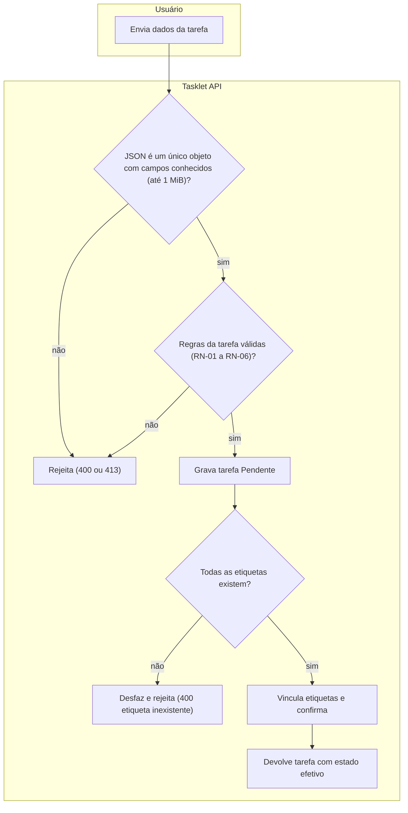

| # | Passo | Ator | Entidade (C/R/U/D) | Regra / decisão | Evidência |
|---|---|---|---|---|---|
| 1 | Recebe e valida o formato do pedido | Sistema | — | RN-12 | `internal/handlers/tarefas.go:52-82` |
| 2 | Valida regras da tarefa | Sistema | Tarefa | RN-01 a RN-06 | `internal/service/tarefas.go:56-127` |
| 3 | Grava a tarefa (estado padrão Pendente) | Sistema | Tarefa (C) | Default `estado = 0` | `internal/repository/store.go:142-146`, `001_base.sql:5` |
| 4 | Vincula etiquetas | Sistema | Vínculo (C), Etiqueta (R) | RN-07 | `internal/repository/store.go:130-140` |
| 5 | Devolve a tarefa com estado efetivo | Sistema → Usuário | Tarefa (R) | RN-08 | `internal/service/tarefas.go:176-183`, `internal/handlers/tarefas.go:101-102` |

**Exceções e caminhos alternativos:**
- Corpo > 1 MiB → 413; JSON com campo desconhecido, múltiplos objetos ou não-objeto → 400 (`internal/handlers/tarefas.go:52-82`)
- `nome`, `repeticao` ou `tag_ids` = `null` → 400 (`internal/service/tarefas.go:57-59`)
- Etiqueta inexistente → transação desfeita, 400 "etiqueta inexistente" (`internal/repository/store.go:44-45`)

### 6.2 Consultar tarefas

| SIPOC | |
|---|---|
| **Fornecedores** | Usuário, Relógio |
| **Entradas** | Filtros `estado` (0, 1, 2 ou `todos`), `tag_id`, `limit`, `offset`; ou `id` |
| **Processo** | Busca tarefas, calcula o estado efetivo com o instante atual e devolve paginado |
| **Saídas** | Lista de tarefas (padrão: não concluídas, 50 por página) ou uma tarefa |
| **Clientes** | Usuário |

- **Gatilho:** `GET /tarefas` e `GET /tarefas/{id}` (`internal/router.go:17,19`)
- **Resultado esperado:** visão atual das tarefas, com atrasos identificados
- **Frequência/volume:** página padrão 50, máximo 100 (`internal/handlers/tarefas.go:106,128`)

**Fluxo por raias**

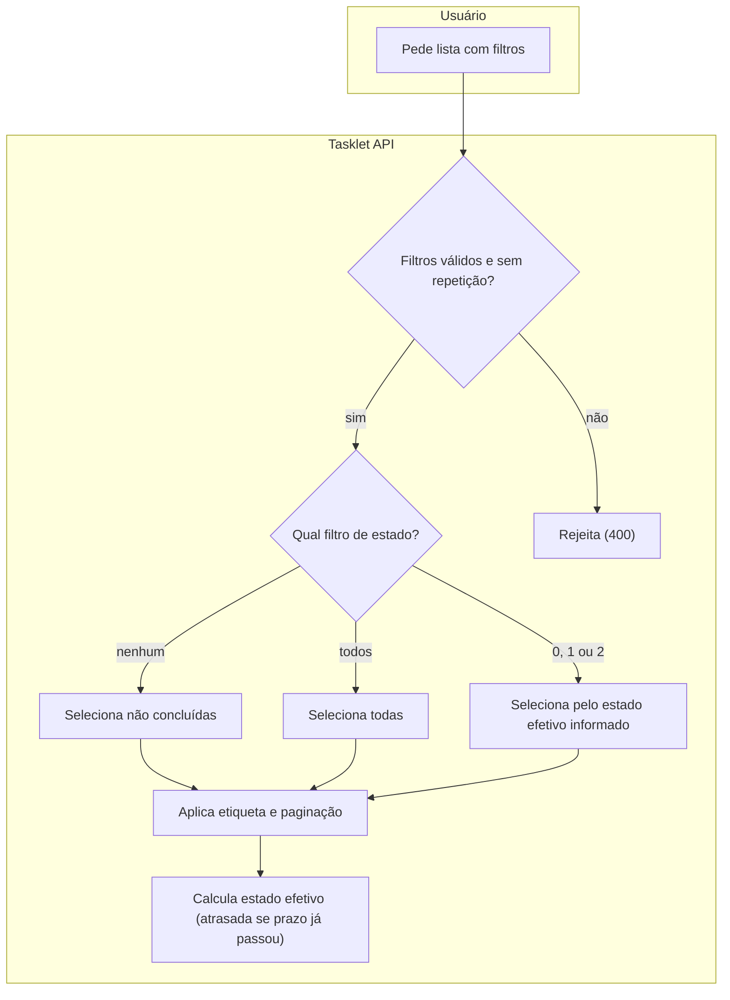

| # | Passo | Ator | Entidade (C/R/U/D) | Regra / decisão | Evidência |
|---|---|---|---|---|---|
| 1 | Valida filtros e paginação | Sistema | — | RN-13 | `internal/handlers/tarefas.go:104-144` |
| 2 | Busca tarefas pelo estado efetivo, etiqueta e página | Sistema | Tarefa (R), Vínculo (R) | RN-08, RN-14 | `internal/repository/store.go:86-128` |
| 3 | Carrega etiquetas de cada tarefa | Sistema | Etiqueta (R) | — | `internal/repository/store.go:61-75,122-126` |
| 4 | Calcula estado efetivo e devolve | Sistema → Usuário | Tarefa (R) | RN-08 | `internal/service/tarefas.go:161-169,188-198` |
| 4b | Consulta individual por id | Usuário | Tarefa (R) | RN-08 | `internal/service/tarefas.go:184-187` |

**Exceções e caminhos alternativos:**
- Parâmetro desconhecido, repetido ou fora do intervalo → 400 (`internal/handlers/tarefas.go:108-142`)
- Id não inteiro positivo → 400; tarefa inexistente → 404 (`internal/handlers/tarefas.go:83-90`, `internal/repository/store.go:38-39`)

### 6.3 Editar tarefa

| SIPOC | |
|---|---|
| **Fornecedores** | Usuário |
| **Entradas** | `id` + subconjunto dos campos da tarefa (ausente = mantém; `null` = limpa, onde permitido) |
| **Processo** | Bloqueia a tarefa, recusa se concluída, aplica alterações, revalida e grava |
| **Saídas** | Tarefa atualizada; etiquetas substituídas se `tag_ids` enviado |
| **Clientes** | Usuário |

- **Gatilho:** `PATCH /tarefas/{id}` (`internal/router.go:20`)
- **Resultado esperado:** tarefa aberta com novos dados
- **Frequência/volume:** Não identificado no código

**Fluxo por raias**

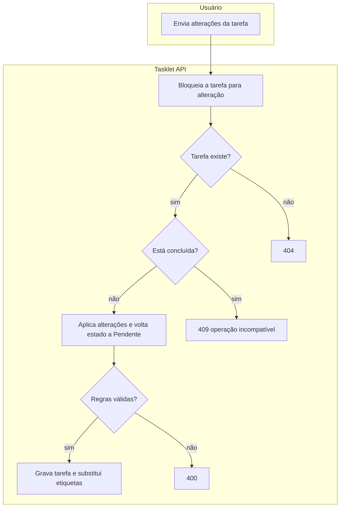

| # | Passo | Ator | Entidade (C/R/U/D) | Regra / decisão | Evidência |
|---|---|---|---|---|---|
| 1 | Recebe e valida formato | Sistema | — | RN-12 | `internal/handlers/tarefas.go:164-172` |
| 2 | Bloqueia a tarefa (serializa alterações concorrentes) | Sistema | Tarefa (R) | — | `internal/repository/store.go:169-181` |
| 3 | Recusa tarefa concluída | Sistema | Tarefa | RN-09 | `internal/service/tarefas.go:200-203` |
| 4 | Aplica alterações parciais e revalida | Sistema | Tarefa (U) | RN-01 a RN-06, RN-10 | `internal/service/tarefas.go:17-30,56-104,204-205` |
| 5 | Grava e substitui vínculos de etiquetas | Sistema | Tarefa (U), Vínculo (D/C) | RN-07 | `internal/repository/store.go:186-192,130-140` |

**Exceções e caminhos alternativos:**
- Tarefa concluída → 409 (`internal/handlers/tarefas.go:45-46`)
- Etiqueta inexistente → 400 e nada é gravado (`internal/repository/store.go:44-45`)

### 6.4 Concluir tarefa (e gerar próxima ocorrência)

| SIPOC | |
|---|---|
| **Fornecedores** | Usuário, Relógio |
| **Entradas** | `id` (sem corpo) |
| **Processo** | Marca a tarefa como concluída; se recorrente, cria a próxima ocorrência com datas avançadas em `repeticao` dias |
| **Saídas** | Tarefa Concluída; nova tarefa Pendente vinculada à origem (se recorrente) |
| **Clientes** | Usuário |

- **Gatilho:** `POST /tarefas/{id}/concluir` (`internal/router.go:22`)
- **Resultado esperado:** ciclo da ocorrência fechado e o próximo ciclo aberto
- **Frequência/volume:** Não identificado no código

**Fluxo por raias**

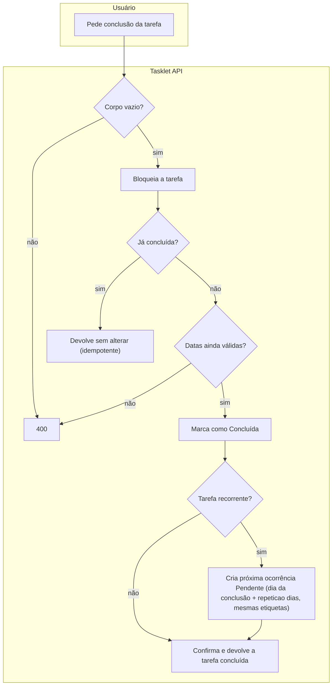

**Interação entre participantes**

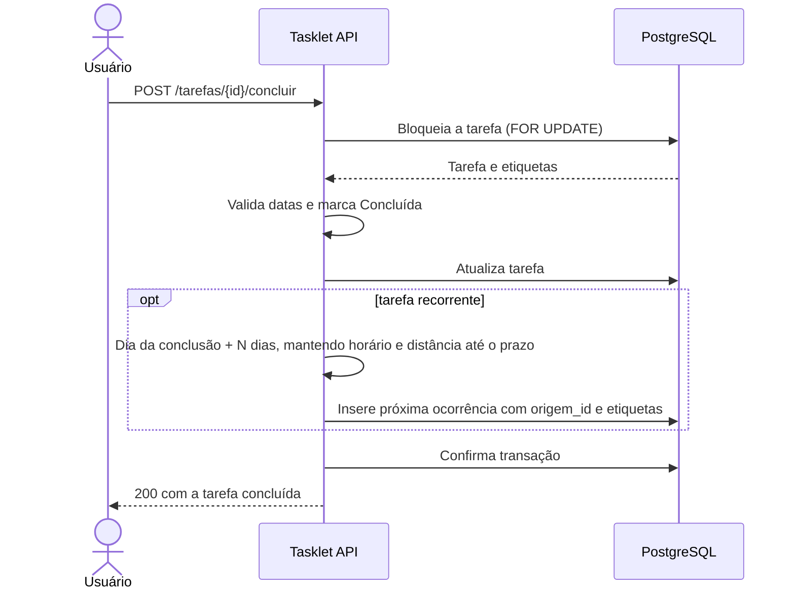

| # | Passo | Ator | Entidade (C/R/U/D) | Regra / decisão | Evidência |
|---|---|---|---|---|---|
| 1 | Recusa pedido com corpo | Sistema | — | RN-15 | `internal/handlers/tarefas.go:185-199` |
| 2 | Bloqueia a tarefa | Sistema | Tarefa (R) | — | `internal/repository/store.go:175` |
| 3 | Ignora se já concluída | Sistema | Tarefa | RN-11 | `internal/service/tarefas.go:211-213` |
| 4 | Revalida datas | Sistema | Tarefa | RN-03 a RN-06 | `internal/service/tarefas.go:214-216` |
| 5 | Marca como Concluída | Usuário | Tarefa (U) | — | `internal/service/tarefas.go:217`, `internal/repository/store.go:186` |
| 6 | Gera próxima ocorrência a partir do dia da conclusão (copia nome, descrição, recorrência e etiquetas) | Sistema | Tarefa (C), Vínculo (C) | RN-05, RN-16 | `internal/service/tarefas.go:137-159,218-229`, `internal/repository/store.go:193-197` |

**Exceções e caminhos alternativos:**
- Já concluída → 200 sem mudança e sem nova ocorrência (`internal/service/tarefas.go:211-213`)
- Datas avançadas fora de 1–9999 ou salto > 3.660.000 dias → 400 (`internal/service/tarefas.go:142-148`)
- Já existe ocorrência com o mesmo `origem_id` → 409 (`002_recorrencia.sql:5`, `internal/repository/store.go:46-47`) — na prática inatingível porque concluída não volta a abrir

### 6.5 Excluir tarefa

| SIPOC | |
|---|---|
| **Fornecedores** | Usuário |
| **Entradas** | `id` |
| **Processo** | Remove a tarefa definitivamente |
| **Saídas** | 204; vínculos com etiquetas removidos; ocorrência seguinte perde o vínculo de origem |
| **Clientes** | Usuário |

- **Gatilho:** `DELETE /tarefas/{id}` (`internal/router.go:21`)
- **Resultado esperado:** tarefa deixa de existir, em qualquer estado
- **Frequência/volume:** Não identificado no código

| # | Passo | Ator | Entidade (C/R/U/D) | Regra / decisão | Evidência |
|---|---|---|---|---|---|
| 1 | Remove a tarefa (exclusão física, sem lixeira) | Usuário | Tarefa (D) | RN-17 | `internal/repository/store.go:205-208` |
| 2 | Remove vínculos com etiquetas | Sistema (banco) | Vínculo (D) | Cascata | `001_base.sql:15` |
| 3 | Desfaz o vínculo "origem" da próxima ocorrência | Sistema (banco) | Tarefa (U) | `ON DELETE SET NULL` | `002_recorrencia.sql:5` |

**Exceções e caminhos alternativos:**
- Tarefa inexistente → 404 (`internal/repository/store.go:209-217`)

### 6.6 Manter etiquetas

| SIPOC | |
|---|---|
| **Fornecedores** | Usuário |
| **Entradas** | `nome` (criar/renomear), `id` (renomear/excluir) |
| **Processo** | Lista, cria, renomeia ou exclui etiquetas |
| **Saídas** | Etiqueta (201 ao criar, 200 ao renomear), lista ordenada por id, 204 ao excluir |
| **Clientes** | Usuário; processos 6.1 e 6.3 |

- **Gatilho:** `GET /tags`, `POST /tags`, `PATCH /tags/{id}`, `DELETE /tags/{id}` (`internal/router.go:23-26`)
- **Resultado esperado:** catálogo de etiquetas disponível para classificar tarefas
- **Frequência/volume:** Não identificado no código (lista sem paginação)

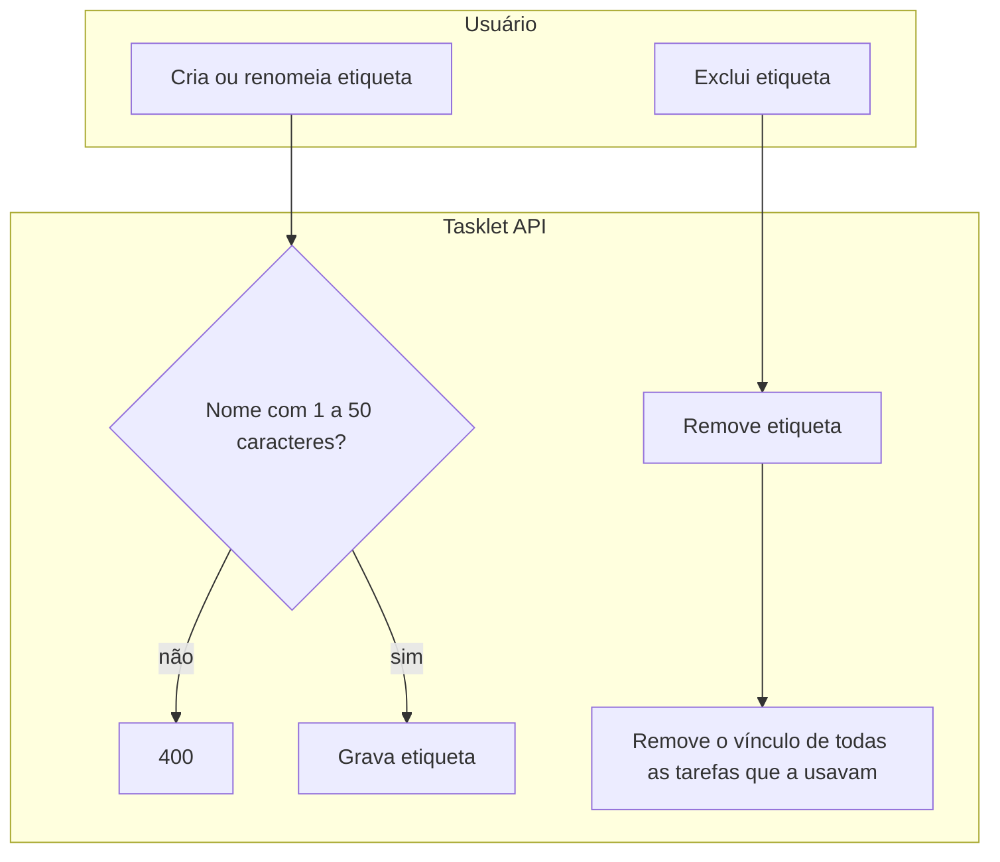

| # | Passo | Ator | Entidade (C/R/U/D) | Regra / decisão | Evidência |
|---|---|---|---|---|---|
| 1 | Lista etiquetas | Usuário | Etiqueta (R) | — | `internal/repository/store.go:220-235` |
| 2 | Cria ou renomeia etiqueta | Usuário | Etiqueta (C/U) | RN-01 (nome), RN-18 | `internal/handlers/tarefas.go:226-256`, `internal/repository/store.go:236-246` |
| 3 | Exclui etiqueta e desvincula das tarefas | Usuário / Sistema (banco) | Etiqueta (D), Vínculo (D) | Cascata | `internal/repository/store.go:247-250`, `001_base.sql:16` |

**Exceções e caminhos alternativos:**
- Criar ou renomear com nome já usado (sem diferenciar maiúsculas) → 409
- Renomear ou excluir etiqueta inexistente → 404 (`internal/repository/store.go:38-39,214-215`)

### 6.7 Disponibilizar serviço (suporte)

| SIPOC | |
|---|---|
| **Fornecedores** | Operação / orquestrador (Docker Compose) |
| **Entradas** | Variáveis `PORT`, `DATABASE_URL` ou `DB_*`; sinais SIGINT/SIGTERM |
| **Processo** | Conecta no banco, aplica migrações pendentes, abre o HTTP, responde sondas e encerra com graça |
| **Saídas** | API ouvindo na porta; `schema_migrations` atualizada; `/healthz` e `/readyz` |
| **Clientes** | Usuário (indiretamente), orquestrador |

- **Gatilho:** início do processo (`main.go:74-82`)
- **Resultado esperado:** API pronta com o schema na versão do código
- **Frequência/volume:** a cada deploy/reinício

| # | Passo | Ator | Entidade (C/R/U/D) | Regra / decisão | Evidência |
|---|---|---|---|---|---|
| 1 | Conecta no banco (timeout 10 s) | Sistema | — | — | `internal/db/db.go:15-48` |
| 2 | Aplica migrações pendentes numa transação com trava exclusiva | Sistema | Migração (C/R), Tarefa (U em 002) | RN-19 | `internal/db/migrate.go:15-51` |
| 3 | Abre o HTTP (porta padrão 8080) | Sistema | — | — | `main.go:20-53` |
| 4 | Responde vivacidade e prontidão (banco acessível em 2 s) | Orquestrador | — | — | `internal/router.go:27-38` |
| 5 | Encerra com graça em até 10 s ao receber sinal | Orquestrador | — | — | `main.go:60-72,76` |

**Exceções e caminhos alternativos:**
- Falha de conexão ou migração → processo termina com código 1 (`main.go:78-81`)
- Banco indisponível em operação → `/readyz` 503 (`internal/router.go:33-35`)

## 7. Ciclos de vida das entidades

### 7.1 Tarefa

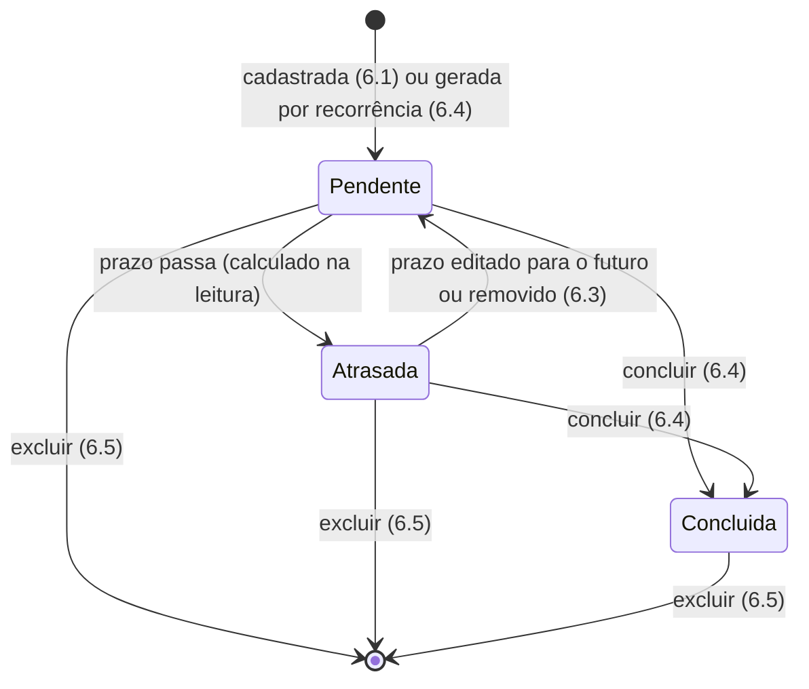

| De → Para | Gatilho | Ator | Processo | Evidência |
|---|---|---|---|---|
| — → Pendente | `POST /tarefas` | Usuário | 6.1 | `001_base.sql:5` |
| — → Pendente | Conclusão de tarefa recorrente | Sistema | 6.4 | `internal/service/tarefas.go:225-229` |
| Pendente → Atrasada | `prazo < agora` no momento da leitura (não é gravado) | Relógio | 6.2 | `internal/service/tarefas.go:161-169`, `internal/repository/store.go:88` |
| Atrasada → Pendente | Edição grava estado 0; o efetivo depende do novo prazo | Usuário | 6.3 | `internal/service/tarefas.go:204` |
| Pendente/Atrasada → Concluída | `POST /tarefas/{id}/concluir` | Usuário | 6.4 | `internal/service/tarefas.go:217` |
| qualquer → removida | `DELETE /tarefas/{id}` | Usuário | 6.5 | `internal/repository/store.go:205-208` |

> Concluída é estado final: não há reabertura e a edição é bloqueada (409). "Atrasada" nunca é gravado — a migração 002 converteu os registros antigos com `estado = 2` para `0` (`002_recorrencia.sql:4`).

## 8. Matrizes de responsabilidade

### 8.1 Ator × Entidade (CRUD)
| Ator \ Entidade | Tarefa | Etiqueta | Vínculo tarefa–etiqueta |
|---|---|---|---|
| Usuário | C R U D | C R U D | C R D (indireto, via tarefa) |
| Sistema (recorrência, cascatas) | C U | — | C D |
| Relógio | R (define atraso) | — | — |

### 8.2 Processo × Entidade (CRUD)
| Processo \ Entidade | Tarefa | Etiqueta | Vínculo |
|---|---|---|---|
| 6.1 Cadastrar tarefa | C R | R (FK) | C |
| 6.2 Consultar tarefas | R | R | R |
| 6.3 Editar tarefa | R U | R (FK) | D C |
| 6.4 Concluir tarefa | R U C | R | D C |
| 6.5 Excluir tarefa | D (U na sucessora) | — | D |
| 6.6 Manter etiquetas | — | C R U D | D |
| 6.7 Disponibilizar serviço | U (migração 002) | — | — |

## 9. Eventos, integrações e handoffs

| Evento / mensagem / arquivo | Produtor | Consumidor | Meio | Processo que inicia | Evidência |
|---|---|---|---|---|---|
| Tarefa concluída com `repeticao > 0` | Usuário (6.4) | Sistema (mesma transação) | Interno (síncrono) | Nova ocorrência Pendente | `internal/service/tarefas.go:218-229` |
| SIGINT / SIGTERM | Operação / orquestrador | Tasklet API | Sinal de SO | Encerramento gracioso | `main.go:76` |
| Sondas `/healthz`, `/readyz` | Orquestrador | Tasklet API | HTTP | — | `internal/router.go:27-38` |
| Migrações SQL embutidas | Código (build) | PostgreSQL | SQL no startup | 6.7 | `internal/db/migrate.go:11-12` |

Não há filas, e-mails, webhooks nem integrações de terceiros.

## 10. Regras de negócio e decisões

| ID | Regra (em português) | Onde se aplica (processo/passo) | Parâmetros (constante/config) | Confiança | Evidência |
|---|---|---|---|---|---|
| RN-01 | Nome (tarefa ou etiqueta) é obrigatório, sem espaços nas pontas, com 1 a 50 caracteres | 6.1, 6.3, 6.6 | 50 | Alta | `internal/service/tarefas.go:48-54` |
| RN-02 | `nome`, `repeticao` e `tag_ids` não podem ser enviados como `null` | 6.1, 6.3 | — | Alta | `internal/service/tarefas.go:57-59` |
| RN-03 | Repetição não pode ser negativa (0 = não recorre) | 6.1, 6.3, 6.4 | ≥ 0 | Alta | `internal/service/tarefas.go:107-109`, `001_base.sql:7` |
| RN-04 | Prazo não pode ser anterior ao dia de execução | 6.1, 6.3, 6.4 | — | Alta | `internal/service/tarefas.go:115-117` |
| RN-05 | Tarefa recorrente exige dia de execução e as próximas datas precisam caber entre os anos 1 e 9999 | 6.1, 6.3, 6.4 | 3.660.000 dias máx. | Alta | `internal/service/tarefas.go:118-125,137-150` |
| RN-06 | Datas devem estar entre os anos 1 e 9999 | 6.1, 6.3, 6.4 | 1–9999 | Alta | `internal/service/tarefas.go:110-114` |
| RN-07 | Etiquetas da tarefa: IDs positivos, sem repetição e existentes; enviar `tag_ids` substitui o conjunto inteiro | 6.1, 6.3 | — | Alta | `internal/service/tarefas.go:87-97`, `internal/repository/store.go:130-140` |
| RN-08 | Estado efetivo: concluída fica concluída; senão é atrasada se o prazo é anterior a agora, pendente caso contrário | 6.1–6.4 | — | Alta | `internal/service/tarefas.go:161-169`, `internal/repository/store.go:88` |
| RN-09 | Tarefa concluída não pode ser editada | 6.3 | 409 | Alta | `internal/service/tarefas.go:201-203` |
| RN-10 | Editar uma tarefa aberta regrava o estado como Pendente | 6.3 | — | Alta | `internal/service/tarefas.go:204` |
| RN-11 | Concluir uma tarefa já concluída não faz nada e não gera nova ocorrência | 6.4 | — | Alta | `internal/service/tarefas.go:211-213` |
| RN-12 | Pedido deve ser um único objeto JSON, só com campos conhecidos, até 1 MiB | 6.1, 6.3, 6.6 | 1 MiB | Alta | `internal/handlers/tarefas.go:52-82` |
| RN-13 | Listagem: padrão 50 por página, máximo 100; filtros desconhecidos ou repetidos são rejeitados | 6.2 | 50 / 100 | Alta | `internal/handlers/tarefas.go:106-143` |
| RN-14 | Sem filtro de estado, a listagem mostra só tarefas não concluídas (pendentes e atrasadas), ordenadas por id | 6.2 | — | Alta | `internal/repository/store.go:89,103` |
| RN-15 | Conclusão não aceita corpo na requisição | 6.4 | — | Alta | `internal/handlers/tarefas.go:196-199` |
| RN-16 | Próxima ocorrência: copia nome, descrição, repetição e etiquetas; `dia_execucao` = dia da conclusão (fuso America/Recife) + `repeticao` dias, mantendo o horário original; `prazo` mantém a mesma distância do `dia_execucao`; aponta para a origem; cada tarefa tem no máximo uma sucessora | 6.4 | America/Recife | Alta | `internal/service/tarefas.go` (`nextOccurrence`), `002_recorrencia.sql:5` |
| RN-17 | Exclusão é definitiva e vale para qualquer estado | 6.5 | — | Alta | `internal/repository/store.go:205-208` |
| RN-18 | Nome de etiqueta é único, sem diferenciar maiúsculas; repetir → 409 "Já existe etiqueta com esse nome" | 6.6 | índice `tag_nome_unico` | Alta | `003_tag_nome_unico.sql`, `internal/repository/store.go` (`SaveTag`) |
| RN-19 | Migrações são aplicadas uma única vez, em ordem de nome, todas ou nenhuma, com trava contra instâncias concorrentes | 6.7 | lock 734832190 | Alta | `internal/db/migrate.go:15-51` |

## 11. Pontos de atenção do processo

- **Passos manuais / fora do sistema:** não há usuários nem autenticação — qualquer cliente com acesso à porta lê e altera tudo; o sistema é mono-usuário por decisão (`internal/router.go:17-26`). Não há lembrete/aviso de atraso: o usuário só descobre consultando.
- **Gargalos e laços de retrabalho:** sem reabertura — conclusão por engano exige excluir a concluída e recadastrar (e, se recorrente, a sucessora já terá sido criada). Listagem carrega etiquetas tarefa a tarefa (N+1 consultas, até 100 por página) (`internal/repository/store.go:122-126`).
- **Estados sem saída ou inatingíveis:** Concluída é final (confirmado como intencional). Atrasada (2) existe no banco (`CHECK`) mas nunca é gravada. O conflito 409 por `origem_id` duplicado é praticamente inatingível.
- **Processos órfãos:** `scripts/init.sql` não é referenciado por nenhum arquivo e diverge das migrações (sem `origem_id`, `TIMESTAMP` sem fuso) — candidato a remoção. `GET /tags` não pagina.
- **Regras hardcoded:** fuso `America/Recife` para recorrência (`internal/service/tarefas.go:129-135`), nome ≤ 50, página 50/100, corpo 1 MiB, timeouts 2/5/10/15/30/60 s.
- **Cobertura de testes:** cobrem cadastro, listagem, roteamento, conclusão/recorrência, unicidade de etiquetas e a migração 003; edição e exclusão ainda sem teste.
- **Decisões validadas com o dono do produto (2026-10-21):**

| # | Pergunta | Decisão | AS-IS atende? |
|---|---|---|---|
| 1 | Concluída deve ser irreversível? | Sim, sem "reabrir" | Sim |
| 2 | Excluir uma ocorrência encerra a série? | Não | Sim |
| 3 | Próxima ocorrência parte das datas da original? | Não: deve partir da **data de conclusão** | Sim, implementado (RN-16) |
| 4 | Recorrência além de dias (semanal/mensal)? | Não, só em dias | Sim |
| 5 | Por que fuso America/Recife fixo? | Projeto pessoal, um só fuso | Sim |
| 6 | Etiquetas com nome repetido são aceitáveis? | Não | Sim, implementado (RN-18) |
| 7 | Haverá múltiplos usuários? | Não | Sim (ausência de autenticação é aceita) |

- **Mudanças implementadas (2026-10-21):**
  - **RN-16:** a sucessora parte do *dia* da conclusão (fuso America/Recife), mantendo o horário original de `dia_execucao`. Efeito: concluir antes do dia planejado também antecipa a próxima ocorrência.
  - **RN-18:** migração `003_tag_nome_unico.sql` funde duplicatas já gravadas na etiqueta de menor id (os vínculos com tarefas são preservados) e cria índice único em `lower(nome)`.

## 12. Glossário de domínio

| Termo no código | Significado de negócio | Onde aparece |
|---|---|---|
| `task` / Tarefa | Item a fazer | `001_base.sql:1`, `internal/models/tarefa.go:19` |
| `tag` / Etiqueta | Rótulo para classificar tarefas | `001_base.sql:10` |
| `possui_uma` | Vínculo tarefa–etiqueta (muitos-para-muitos) | `001_base.sql:14` |
| `estado` | Situação da tarefa: 0 Pendente, 1 Concluída, 2 Atrasada (calculada) | `internal/models/tarefa.go:8-12` |
| `prazo` | Data/hora limite; define atraso | `internal/models/tarefa.go:22` |
| `dia_execucao` | Data planejada para fazer a tarefa | `internal/models/tarefa.go:26` |
| `repeticao` | Intervalo de recorrência em dias (0 = única) | `internal/models/tarefa.go:25`, `internal/service/tarefas.go:145` |
| `origem_id` | Tarefa da qual esta ocorrência foi gerada | `002_recorrencia.sql:5` |
| `todos` | Valor do filtro que inclui concluídas na listagem | `internal/handlers/tarefas.go:115` |

## Apêndice — rastreabilidade

| Processo | Arquivos |
|---|---|
| 6.1 | `internal/router.go:18`, `internal/handlers/tarefas.go:91-103`, `internal/service/tarefas.go:56-127,176-183`, `internal/repository/store.go:130-166` |
| 6.2 | `internal/router.go:17,19`, `internal/handlers/tarefas.go:104-163`, `internal/service/tarefas.go:161-198`, `internal/repository/store.go:61-128` |
| 6.3 | `internal/router.go:20`, `internal/handlers/tarefas.go:164-179`, `internal/service/tarefas.go:199-208`, `internal/repository/store.go:169-203` |
| 6.4 | `internal/router.go:22`, `internal/handlers/tarefas.go:180-206`, `internal/service/tarefas.go:129-159,209-231`, `internal/repository/store.go:169-203` |
| 6.5 | `internal/router.go:21`, `internal/handlers/tarefas.go:207-217`, `internal/repository/store.go:205-218` |
| 6.6 | `internal/router.go:23-26`, `internal/handlers/tarefas.go:218-267`, `internal/repository/store.go:220-250` |
| 6.7 | `main.go`, `internal/db/db.go`, `internal/db/migrate.go`, `internal/db/migrations/*.sql`, `docker-compose.yml`, `Dockerfile` |
